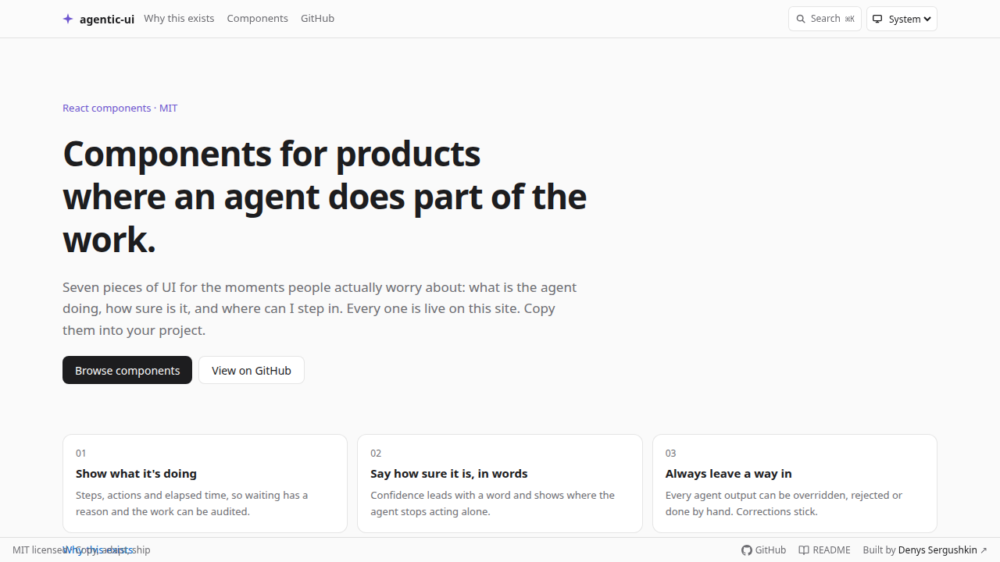
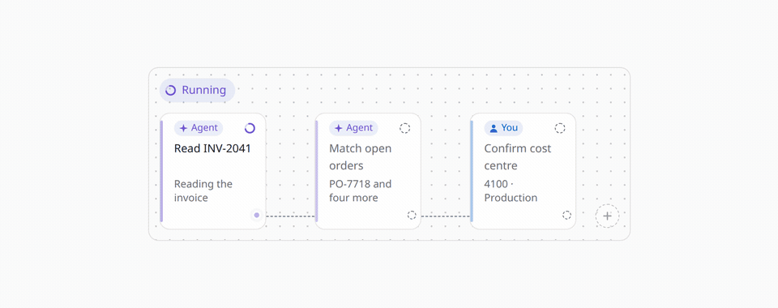

# agentic-ui

[](https://github.com/sergushkincom/agentic-ui/actions/workflows/ci.yml)
[](LICENSE)
[](https://agentic-ui-docs.vercel.app)

[DENYS: one sentence, in your words, on what this library is for.]

React components for products where an agent does part of the work: streaming text, thinking states, confidence, step inspection, expressions, pinned output, human override, tool calls, decisions and fallbacks.

Every component answers one question people actually ask when software acts for them: **what is it doing, how sure is it, and where can I step in?**

**Live docs:** [agentic-ui-docs.vercel.app](https://agentic-ui-docs.vercel.app)





RunGraph steps advance one by one, WaitForPerson asks for approval, then RunLog fills.

## Components

| Component | The design question |
|---|---|
| `StreamingText` | How do you show an answer that is still being written, without making people read a moving target? |
| `ThinkingState` | What does a person need to see to decide whether to keep waiting? |
| `ConfidenceBar` | What does 72% mean to someone who has to act on it? |
| `HumanOverride` | When a person corrects the agent, how do they know the correction will stick? |
| `ToolCallFeed` | How do you show what an agent did in other systems without dumping JSON on everyone? |
| `RunNode` | What does a person need on a single step to see whether it is waiting, working, finished, or stuck? |
| `RunGraph` | How do you show a few connected steps without pretending to be an editor? |
| `StepPicker` | When someone adds a step, how do they find the one a person has to do, not only the ones the agent can run? |
| `RunLog` | How do you inspect one step's data without turning the whole run into a dump? |
| `RunHistory` | Which past run is this, and did it finish? |
| `RunChat` | How does a person start a run and watch it work, in the same place they asked? |
| `AgentHarness` | What does this step need before it can run, and what is still unplugged? |
| `StepInspector` | When a step in the agent's work is wrong, where do you look? |
| `ExpressionField` | How do you point a step at an earlier field without hiding the link in syntax? |
| `PinnedOutput` | How do later steps keep moving when you do not want to run this step again? |
| `AgentDecisionCard` | What does a person need to read, in what order, to approve an agent's action responsibly? |
| `WaitForPerson` | When a run stops for a person, what do they need in front of them to let it continue? |
| `ConnectionPicker` | How does a person give the agent an account without the secret ever sitting on screen? |
| `FallbackBoundary` | What happens to the person's task when the agent doesn't come back? |
| `StepError` | When one step fails, what exactly was wrong with the data? |

Each docs page has a live demo with scenarios, the design decisions, usage, props, accessibility notes and a "Deliberately not built" list.

## Use them

Not an npm package, on purpose. The shadcn CLI copies the source into your project.

```bash
npx shadcn add https://agentic-ui-docs.vercel.app/r/confidence-bar.json
```

That adds ConfidenceBar. Each component page on the docs site has the command for that component. The registry index is [https://agentic-ui-docs.vercel.app/r/registry.json](https://agentic-ui-docs.vercel.app/r/registry.json). Then import the tokens next to Tailwind (`@import "./tokens.css";`) and use `import { ConfidenceBar } from "@/components/agentic"`. Needs React 19 and Tailwind CSS 4. Components read colours from CSS variables in `tokens.css` (light and dark), so restyling is overriding tokens. Authorship has its own pair of tokens: `--agent` for what the agent wrote, `--human` for what a person changed.

## Run the docs site

```bash
npm ci
npm run dev        # http://localhost:3000
npm test           # confidence bands and formatters
npm run typecheck
npm run lint
npm run build
```

Next.js 15 (App Router), React 19, TypeScript strict, Tailwind CSS 4. Fake data throughout: one made-up scenario, an agent matching a supplier invoice to a purchase order in an ERP. No backend, no model calls.

## Layout

- `src/components/agentic/` — the library. One file per component, `format.ts` for pure logic, `marks.tsx` for shared marks and buttons, `stroke-morph.ts` for the working-status stroke morph.
- `src/lib/registry.ts` — every docs page, and `/r/registry.json`, renders from this list.
- `src/app/components/demos.tsx` — the live demos.
- `src/app/r/[name]/route.ts` — one component's shadcn registry item.
- `COMPONENTS.md` — the component list.
- `AGENTS.md` — how to add a component.
- `docs/PROJECT.md` — what this site is for, and what is next.

## Credits

The spinner on `ThinkingState` and `ToolCallFeed` draws itself into a check or a warning. That stroke morph is adapted from [morphicons](https://github.com/guillermolg00/morphicons) by [Guillermo](https://guillermolg.com) (MIT): resample the stroke, align it with a closed-form rotation and scale, then interpolate. People who prefer reduced motion get an instant swap.

## License

MIT, see [LICENSE](LICENSE).
